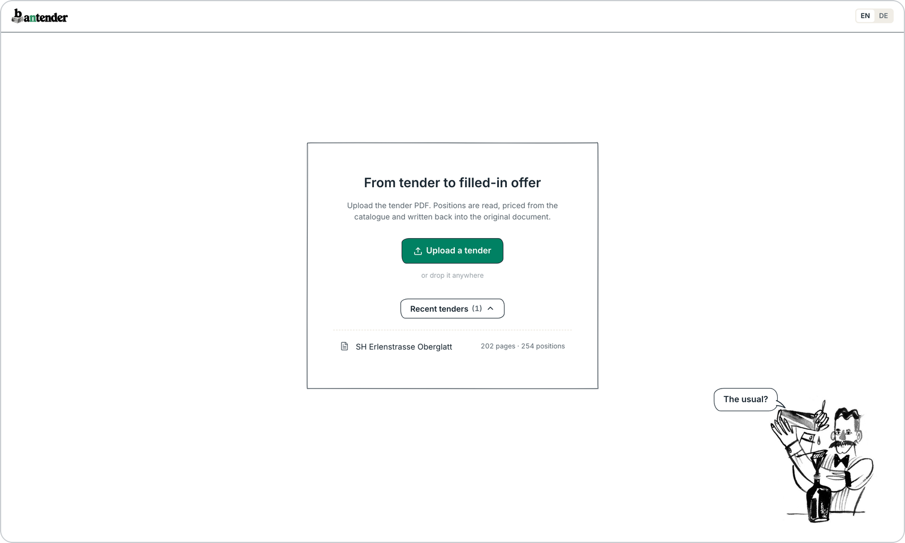
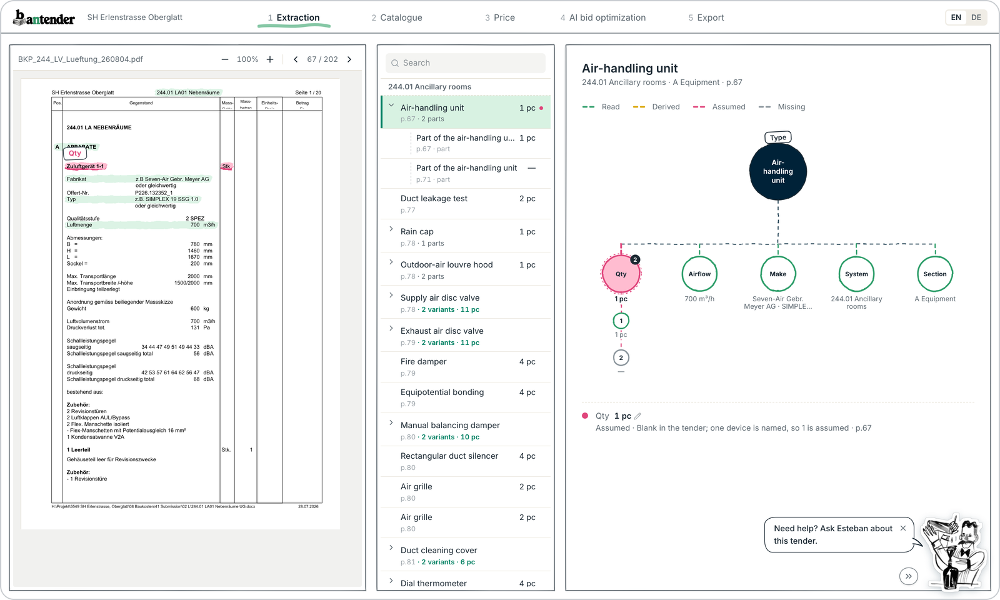
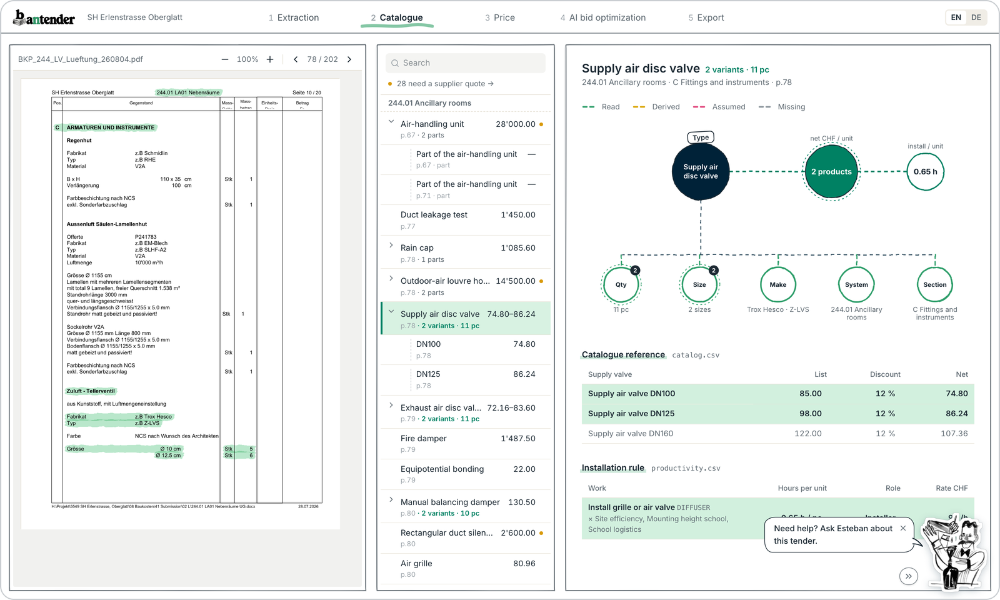
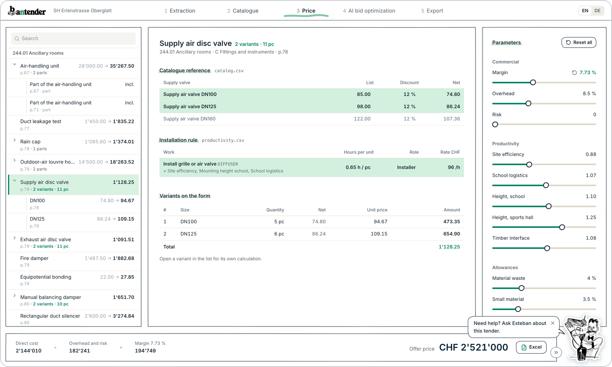
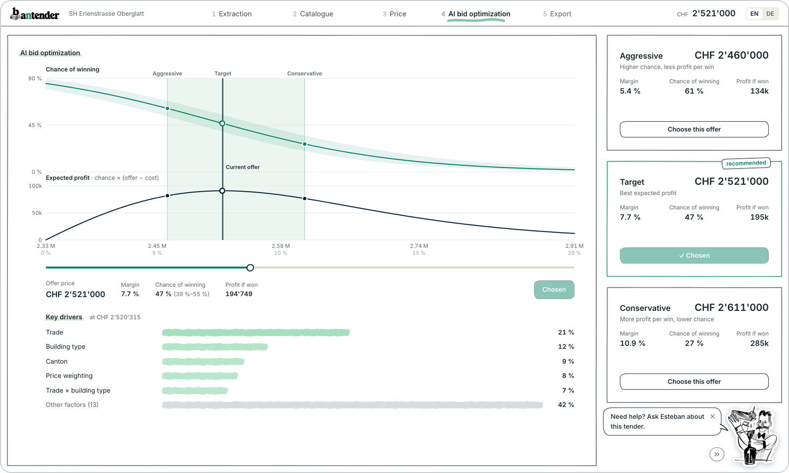
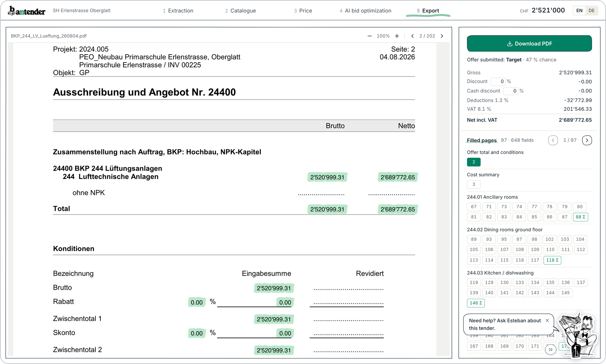
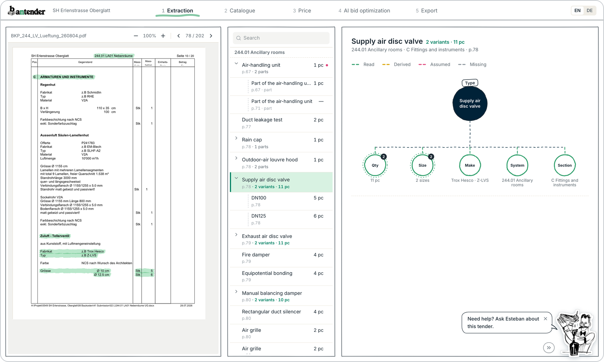
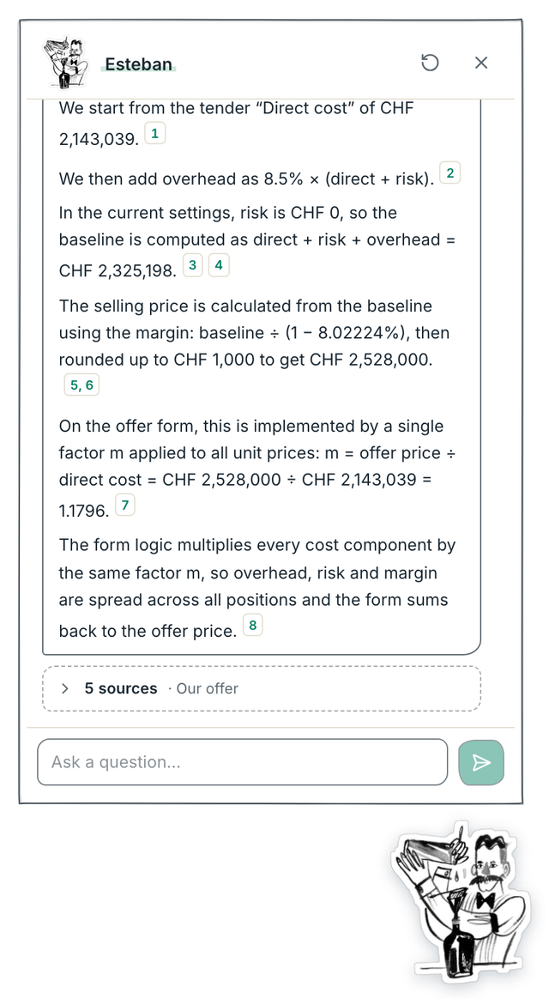

<p align="center">
  
</p>

<h1 align="center">From tender to filled-in offer</h1>

<p align="center">
  <a href="https://bantender.duckdns.org"><b>Open the live app</b></a>
  &nbsp;·&nbsp;
  <a href="https://www.youtube.com/watch?v=7SnK-QCKJdk"><b>Watch the demo</b></a>
  &nbsp;·&nbsp;
  <a href="#run-it">Run it locally</a>
</p>


**bantender** turns a public HVAC tender (PDF) into a priced offer, written back into the tender's own LV form.
Every number can be traced to a tender page, a catalogue row or a parameter.
Built for the Equans case at the sprintd hackathon (October 2026).

Estimators told us where the time goes: reading and extracting positions, retyping them into Excel, and writing prices back into the PDF. The calculation itself is simple. So the tool automates the reading and the write-back, and shows the calculation in steps an estimator recognises, so they can check it instead of redoing it.

<br clear="right">

## Demo

<p align="center">
  <a href="https://www.youtube.com/watch?v=7SnK-QCKJdk">
    
  </a>
  <br>
  <sub>Click to watch the demo on YouTube · try it yourself at <a href="https://bantender.duckdns.org">bantender.duckdns.org</a></sub>
</p>

## The flow

The app opens on the bartender with "bantender × Equans"; the wordmark then settles top left, the bartender bottom right ("waiting for your tender"), with the recent tenders in a dropdown at the top and the upload in the middle. After upload the Extraction step opens directly, with nothing selected: the tender's highlights appear only once a position is picked.

<p align="center">
  
</p>

<table>
  <tr>
    <td width="50%" valign="top"><br><sub><b>1 Extraction</b> · the PDF, the positions and the value graph; hovering a value highlights it in the tender</sub></td>
    <td width="50%" valign="top"><br><sub><b>2 Catalogue</b> · product, net price and installation time, with the catalogue and productivity rows</sub></td>
  </tr>
  <tr>
    <td valign="top"><br><sub><b>3 Price</b> · net price → unit price per position, every parameter on the right, the offer price at the bottom</sub></td>
    <td valign="top"><br><sub><b>4 Offer options</b> · aggressive / target / conservative from the win-probability model</sub></td>
  </tr>
  <tr>
    <td valign="top"><br><sub><b>5 Export</b> · the original tender with every price written in</sub></td>
    <td valign="top"><br><sub><b>Variants</b> · one graph per parent, its sizes and quantities underneath</sub></td>
  </tr>
</table>

| Step | What the estimator sees | Can change |
| --- | --- | --- |
| 1 Extraction | The PDF (zoom with +/− or a pinch), the positions, and a graph: the type on top, what the tender says below (quantity, size, airflow, make, system, section). Colour = how a value was obtained; hovering a value marks its row in the PDF with a highlighter. An assumed value also marks what the assumption rests on (e.g. the device name behind a quantity of 1). | Quantity |
| 2 Catalogue | The same graph with the product, its net price and the installation time; below, the catalogue rows (`catalog.csv`) and the installation rule (`productivity.csv`) the position is priced from. | Supplier quote (supplier-package items only) |
| 3 Price | Left: every position, catalogue net price → unit price on the form. Centre: the catalogue and productivity rows, the recap (quantity, hours, unit price, amount) and the few steps from net to unit price. Right: every parameter, each undoable, plus reset all. Bottom: the offer price and an **Excel** download of the whole calculation with live formulas. | Quantity, hours per unit, every parameter, mounting height per system |
| 4 Offer options | Aggressive / Target (recommended) / Conservative from the win-probability model (`backend/app/winprob`), each with margin, chance of winning and expected profit, stacked on the right; the curve on the left to explore any offer in between. Choosing one sets the margin and records the choice (`history/chosen_offers.json` in the data volume, input for retraining). | The offer |
| 5 Export | The filled PDF, the chosen offer, the filled pages in document order grouped by system, conditions, download. | Discount, cash discount |

**Variants and parts.** Positions that are the same item in another size or quantity (e.g. two exhaust valves, DN100 × 5 and DN125 × 6) are listed once, as a parent with its variants underneath; accessories that belong to an item (an air-handling unit's "Zubehör", a rain cap's colour coating) hang under that item as parts. One graph per parent: closed, it shows the parent's values (a sum where it can, e.g. 11 pc; a count where the children differ, e.g. "2 sizes"); clicking such a value, or picking a child in the list, opens it with each child's own value underneath. Same item = same rule, name, unit and catalogue family, so a ground-duct block is not added up across metres and pieces (`backend/app/matching/groups.py`).

Columns can be resized by dragging their edges (within a readable range, remembered per browser). The English view uses English throughout; German names from the tender are translated with a small glossary.

**Excel.** `GET /api/tenders/{id}/pricing.xlsx`: Parameters (inputs in yellow) · Catalogue and Productivity (the rows used) · Positions (material, hours, installation, direct cost per line, as formulas) · Build-up (to the offer price) · Offer form (unit prices and amounts, per system, conditions) · Formulas (in words). Changing a parameter in Excel updates every sheet; recalculated in LibreOffice it matches the app to the centime on every line. The form rounds half up, as Excel does.

**How a value was obtained** (one level per value, not a probability):

| Level | Meaning | Example |
| --- | --- | --- |
| Read | Printed on the position's own rows | quantity column, size row, page header |
| Derived | Worked out from something printed elsewhere | "wie vorbeschrieben", unit conversion, parent item, system by document order where the page header is wrong |
| Assumed | Not in the tender; the tool filled it in | blank quantity on a priced item, taken as 1 |
| Missing | Not in the tender and needed for a price | blank quantity on p.169 |
| Not needed | Not in the tender, and the position is included elsewhere | blank quantity on an accessory block |

## The assistant (Esteban)



Esteban, the bartender in the lower right, answers questions about the tender, our offer and the company's data. Its window is small and leaves the page usable. Each answer is a list of statements, and each statement comes with numbered sources. Clicking a tender source opens its page and outlines the quoted words. A position source opens the position; the offer source opens the price step.


What it can look at (`backend/app/assistant/`):
- the tender text, from the parser's rows (`read_rows`), split into ~900-character chunks and searched with BM25 plus OpenAI embeddings (`text-embedding-3-small`). The index is built once per tender and stored;
- our offer as calculated (offer price, cost build-up, positions);
- every CSV and JSON file in the reference folder (catalogue, productivity rules, parameters, past bids, market snapshots), filtered and aggregated in code, not by the model.

How it avoids making things up. The model (gpt-5.2) must cite a source id and a verbatim quote for every statement. Then two checks run:
1. **Grounding** (code): each quote is looked up in the cited source. Matching ignores line breaks, hyphenation and spacing, and reads two-column pages row by row and column by column. A statement with no quote found is removed.
2. **Support check** (a second model call): it sees each statement and its quotes in context. It removes statements that misread their quote, e.g. the start date of a schedule task read as the submission deadline.

<br clear="right">

The window says how many statements were removed. A reply without sources (a greeting, or "not found") may not contain figures.

Turning it on: `AI_PROVIDER=openai`, `OPENAI_API_KEY` and `OPENAI_BUDGET_USD` in `.env`. Spend is counted per deployment, and the assistant stops when the budget is used up. Expect about USD 0.03 and 5–20 s per question.

Tests: `make test` covers retrieval, grounding and the loop with a scripted model, with no network. `make assistant-eval` asks gpt-5.2 18 real questions on the Oberglatt tender: facts from the conditions, our bid and our data, three questions the documents cannot answer, and two with a wrong premise. Latest run: 18/18.

## Writing back into the tender

The tender requires the original LV to be returned filled in, with the text unchanged (p.97: "zwingend das zugestellte Originalleistungsverzeichnis ausgefüllt einzureichen"). The filler only adds numbers. It finds each field from the page itself (the column under "Einheitspreis" / "Betrag", the row of the position, the dotted placeholders) and writes into the blank space, so nothing is hardcoded to this tender.

What is filled (Oberglatt: 648 fields on 97 pages):
- unit price and amount of every priced position, "inkl." where a position is included elsewhere;
- group totals ("Total aller Einkanal-Volumenstromregler …");
- per section: "Total" rows; in section E: installation and transport, services, the hygiene inspection, the CAD material list row and the installation days;
- each system's own cost summary (sections A–F and the system total; p.195 prints the wrong system code, the page's system is used);
- p.3 cost summary per system and lot, totals per lot and overall;
- p.2 gross / net and the conditions: discount, cash discount, deductions 1.30 %, VAT 8.1 % (both rates read from the form).

A test checks that no dotted price cell is left on any LV page. Left for the bidder: company details and signatures, the change-order rate sheets on pp.4–6, the hourly-work conditions, and the make/model declarations ("Fabrikat ……").

**How prices reach the form.** SIA 118 Art. 39: surcharges are included in the unit prices. So one factor, m = offer price ÷ direct cost, is applied to every cost component. That spreads project costs, overhead, risk and margin evenly, and the filled form adds up to the offer price within centimes of rounding. Items in sections A–D carry supply prices; their installation goes to section E, as the form asks. Insulation (F, "inkl. Montage") and install-only items keep their labour.

## The calculation

Per position:
- material = quantity × catalogue net price × (1 + waste %);
- hours = quantity × hours per unit × productivity factors (site efficiency as 1/x; mounting height by system location);
- labour = hours × hourly rate;
- direct cost = material + labour.

Project:
- direct cost = Σ positions + transport % + small material % + supplier contingency % + engineering + commissioning + hygiene + documentation;
- baseline = (direct + risk) × (1 + overhead %);
- offer price = baseline ÷ (1 − margin %), rounded up to CHF 1'000.

All rates come from the company's reference data (`data/reference/v2`) or the estimator's edits, which are logged (`GET /api/tenders/{id}/audit`).

## Results on the Oberglatt tender

With the company parameters unedited:
- **Offer price CHF 2'461'000** (margin 5.5 %); factor m = 1.1484;
- form gross total CHF 2'461'001.42; net incl. VAT CHF 2'625'758.08;
- 254 positions read: 22 included elsewhere or out of scope, 232 to price, 231 priced (192 calculated, 39 provisional: 28 supplier quotes, 11 assumptions), 1 without quantity;
- 77 further lines derived from the CAD component lists (ducts per DN and m², bends).

Extraction is checked independently: every unit in the LV's unit column has an extracted position, and the 22 verified example positions are all found with the right product (`tests/`).

**Reference data v2.** The provided catalogue (56 items) covers less than half the positions. We were told the catalogue is not the focus, so `data/reference/v2` keeps every v1 row unchanged and adds 70 synthetic catalogue items and 18 productivity rules (grilles, louvres, kitchen, ground ducts, services …). Replacing them with real company data means replacing two CSV files.

## Run it

Needs Docker.

```bash
cp .env.example .env          # set DOMAIN=localhost for a local run
docker compose up -d --build  # caddy (HTTPS) + web + api
open https://localhost        # accept the local certificate once
```

Drop `data/samples/oberglatt/BKP_244_LV_Lueftung_260804.pdf` on the upload screen. ↑/↓ moves through positions. EN/DE in the top bar.

```bash
make test   # backend tests, ~10 s, no network
make smoke  # smoke-test a running stack (BASE=https://your-domain)
make e2e    # walk the five steps in a browser; numbers on screen must match the API, edits are restored
cd e2e && node shots.mjs && python3 frame.py   # retake the README screenshots (docs/img), read-only
make api    # dev API on :8000
cd frontend && npm install && npm run dev   # UI with hot reload on :5173, proxies /api to https://localhost
```

On the server: `.env` with the real `DOMAIN`, then `make deploy`. Caddy obtains the certificate.

## Layout

```
backend/app/
  parsing/     PyMuPDF rows → page kinds → LV positions with source boxes; tender facts (lots, conditions)
  matching/    lexicon (German HVAC terms → catalogue), product choice by size, CAD duct lines, attributes with certainty
  pricing/     engine (line + project formulas with trace), service (overrides, settings), scenarios (hook for the AI loop)
  offer/       build.py: prices on the form; pdf_fill.py: write them into the original PDF
  assistant/   Esteban, the assistant: tender index, tools, grounding and support check
  api/         FastAPI
backend/tests/ golden positions, parsing completeness, matching, offer reconciliation, API
data/reference/v1, v2   company reference data (server-side; v2 = v1 + synthetic rows)
data/samples/  the Oberglatt tender and the verified examples
frontend/      React + Vite + Tailwind; components/steps/ holds the five steps
e2e/flow.mjs   browser walk-through of the flow; e2e/shots.mjs the README screenshots
deploy/        Caddyfile, smoke test
docs/          flow and infrastructure diagrams, parser decision
```

Parser choice: PyMuPDF alone, about one second per tender. Docling was benchmarked and removed ([docs/parser-benchmark.md](docs/parser-benchmark.md)).

## Path to production (Azure)

Each server component maps to an Azure service:
- Caddy → Front Door;
- containers → Container Apps;
- storage volume → Blob Storage;
- OpenAI → Azure OpenAI, for the assistant and the bid-optimisation loop.

Configuration comes from environment variables only. Storage sits behind an interface with a local implementation now; an Azure one plugs in without code changes elsewhere. Reference data is a versioned folder the company maintains. OpenAI is called only by the assistant, and only with `AI_PROVIDER=openai`; the pipeline and the tests make no calls.
